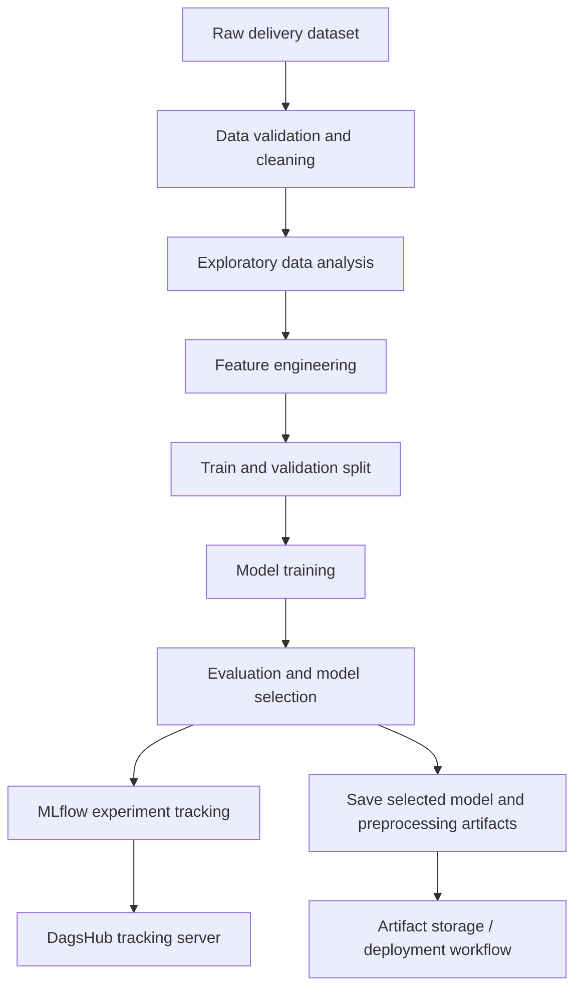

# ETA Time Prediction | End-to-End Machine Learning & MLOps

An end-to-end machine learning project that predicts food-delivery time from order, rider, location, traffic, weather, and other delivery-related features. The project focuses not only on model development, but also on reproducibility, experiment tracking, artifact management, and an automated workflow for taking an ML model toward production.

> **Project status:** Update the implementation-specific commands, model results, and deployment links below to match the current repository before publishing. No performance numbers are claimed here because they have not been verified.

## Table of Contents

- [Problem Statement](#problem-statement)
- [Project Goals](#project-goals)
- [Dataset and Features](#dataset-and-features)
- [Workflow](#workflow)
- [MLOps and Tools](#mlops-and-tools)
- [Repository Structure](#repository-structure)
- [Getting Started](#getting-started)
- [Experiment Tracking](#experiment-tracking)
- [Model Evaluation](#model-evaluation)
- [Reproducibility and Configuration](#reproducibility-and-configuration)
- [Future Improvements](#future-improvements)
- [Author](#author)

## Problem Statement

Accurately estimating delivery time is important for customer experience and delivery operations. Actual delivery duration can be affected by distance, traffic, weather, rider characteristics, order timing, vehicle condition, and other contextual factors.

This project uses historical delivery data to train a regression model that estimates the time required to complete a delivery. The intended output is a predicted delivery duration that can support ETA estimation in a food-delivery workflow.

## Project Goals

- Explore and clean raw delivery data.
- Engineer meaningful features from timestamps and geographic coordinates.
- Train and evaluate machine learning regression models.
- Track experiments and model results with **MLflow** and **DagsHub**.
- Manage model/data artifacts using an object-storage workflow where configured.
- Organize the project so that training and future deployment can be reproduced.

## Dataset and Features

The project uses food-delivery data with fields covering several aspects of an order. The working dataset has included fields such as:

| Feature group | Examples | Purpose |
|---|---|---|
| Rider information | `rider_id`, `age`, `ratings` | Describe rider-related context |
| Geographic coordinates | Restaurant and delivery latitude/longitude | Represent pickup and drop-off locations |
| Order context | `type_of_order`, `type_of_vehicle`, `city_type`, `city_name` | Capture order and operating context |
| External conditions | `weather`, `traffic`, `festival` | Represent conditions that may affect delivery duration |
| Vehicle and delivery details | `vehicle_condition`, `multiple_deliveries` | Capture operational constraints |
| Time features | `order_date`, `order_time_hour`, `day_of_week`, `is_weekend`, `month`, `year` | Capture temporal patterns |
| Engineered features | `distance_km`, `pickup_time_minutes` | Represent route distance and pickup-related timing |
| Target | `time_taken` | Delivery duration to predict |

The exact feature set may change during preprocessing and model selection. Check the training pipeline for the final list of model inputs and target transformations.

## Workflow



### Key data preparation steps

- Handle missing values and inconsistent representations of missing data.
- Parse order timestamps and derive calendar/time-based features.
- Validate latitude and longitude values before calculating geographic distance.
- Derive distance between restaurant and delivery locations.
- Encode categorical variables and scale numerical features where required by the chosen estimator.
- Keep preprocessing fitted on training data and apply the same transformations during inference to reduce data leakage.

## MLOps and Tools

| Tool / technology | Role in the project |
|---|---|
| Python | Core programming language |
| pandas, NumPy | Data manipulation and numerical processing |
| scikit-learn | Preprocessing, model training, and evaluation utilities |
| MLflow | Experiment tracking, parameters, metrics, and artifacts |
| DagsHub | Remote MLflow tracking and collaboration workflow |
| Git and GitHub | Source control and project hosting |
| AWS S3 | Object storage for artifacts, when configured |
| Docker | Containerization for a repeatable runtime, when configured |
| GitHub Actions | Automation for configured CI/CD workflows |

Only the tools and workflows actually configured in the repository should be described as implemented. For example, listing Docker or GitHub Actions here does not by itself mean that a production deployment is already live.

## Repository Structure

The structure below is a recommended overview. Adjust paths and filenames to match the actual repository contents.

```text
ETA-Time-Prediction/
├── data/                   # Raw and/or processed data (often excluded from Git)
├── notebooks/              # EDA and experimentation notebooks, if present
├── src/                    # Reusable source code for preprocessing and training
├── config/                 # Configuration files, if present
├── artifacts/              # Generated model and preprocessing artifacts, if present
├── tests/                  # Automated tests, if present
├── .github/workflows/      # GitHub Actions workflows, if configured
├── Dockerfile              # Container definition, if configured
├── requirements.txt        # Python dependencies
├── .gitignore
└── README.md
```

## Getting Started

### 1. Clone the repository

```bash
git clone https://github.com/sanketdixit18/ETA-Time-Prediction.git
cd ETA-Time-Prediction
```

### 2. Create and activate a virtual environment

**Windows PowerShell**

```powershell
python -m venv venv
.\venv\Scripts\Activate.ps1
```

**macOS / Linux**

```bash
python3 -m venv venv
source venv/bin/activate
```

### 3. Install dependencies

```bash
python -m pip install --upgrade pip
pip install -r requirements.txt
```

### 4. Configure environment variables

If the project uses DagsHub, AWS, or other external services, configure credentials through environment variables or a local `.env` file that is excluded from version control. Never commit access keys, tokens, passwords, or private credentials.

Use placeholder values in `.env.example`, for example:

```dotenv
# Example only — use the variable names required by your code
DAGSHUB_USERNAME=your_username
DAGSHUB_TOKEN=your_token
AWS_ACCESS_KEY_ID=your_access_key_id
AWS_SECRET_ACCESS_KEY=your_secret_access_key
AWS_DEFAULT_REGION=your_region
```

Do not add variables that the code does not use. Follow the repository's configuration and credential-loading implementation.

### 5. Run the pipeline

Run the training and prediction entry points defined in the repository. For example, if the project exposes these scripts, the commands may look like:

```bash
python src/train.py
python src/predict.py
```

**Important:** Replace these example commands with the actual entry points in this repository. Check the source files and configuration before running them.

## Experiment Tracking

MLflow can be used to record parameters, evaluation metrics, and artifacts for each experiment. DagsHub can host the remote MLflow tracking server so experiments can be reviewed outside the local environment.

A typical setup looks like this:

1. Initialize or configure the DagsHub repository.
2. Set the MLflow tracking URI to the project's DagsHub MLflow endpoint.
3. Log model parameters, validation metrics, and relevant artifacts during training.
4. Compare runs and select a model using validation results.
5. Record the selected model and its preprocessing dependencies for reproducibility.

The tracking URI, experiment name, and authentication setup should be taken from the project's actual configuration. Do not put access tokens directly in source code or in this README.

## Model Evaluation

For a regression problem such as delivery-time prediction, useful evaluation metrics include:

- **MAE (Mean Absolute Error):** Average absolute difference between predicted and actual delivery time; straightforward to interpret in the target's units.
- **RMSE (Root Mean Squared Error):** Penalizes larger errors more heavily.
- **R² score:** Measures the proportion of target variance explained by the model relative to a mean baseline.

Report the results from your actual held-out test set here after running the final evaluation:

| Metric | Test result |
|---|---:|
| MAE |3.1291 |
| R² | 0.8278 |


Use a held-out test set for final reporting and avoid selecting models based on test-set performance. Include the target unit (for example, minutes) and the evaluation split details alongside the numbers.

## Reproducibility and Configuration

For more reliable experiments:

- Pin dependency versions in `requirements.txt` after confirming a working environment.
- Fix and document random seeds where applicable.
- Keep data preparation and inference transformations consistent.
- Store large datasets and model artifacts outside Git when appropriate; use the project's configured artifact or data-versioning workflow.
- Record model parameters, metrics, dataset version, and code revision for each experiment.
- Test the training and inference paths from a clean environment before releasing changes.

## Future Improvements

- Add a clear command-line entry point for training, evaluation, and prediction.
- Add automated tests for preprocessing, feature generation, and inference.
- Compare baseline models with tree-based and boosting regressors using a consistent validation strategy.
- Add model explainability and feature-importance analysis.
- Monitor prediction error and data drift after deployment.
- Expose predictions through a documented API and build a small user interface, if required by the project scope.
- Add CI checks for linting, tests, and reproducible builds.

## Author

**Sanket Dixit**

- GitHub: [@sanketdixit18](https://github.com/sanketdixit18)
- Project: [ETA-Time-Prediction](https://github.com/sanketdixit18/ETA-Time-Prediction)

---

If you find this project useful, consider giving the repository a ⭐ on GitHub.
